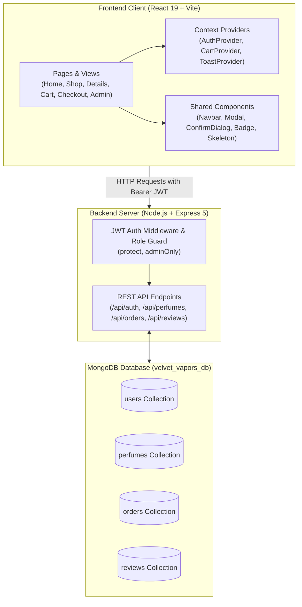
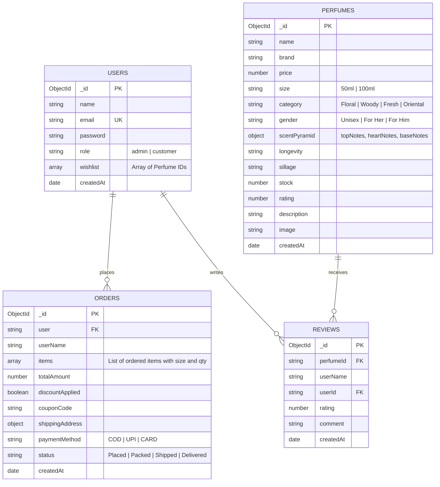

# Academic Project Report: "Velvet Vapors" Luxury Perfume Shop
**Course Code / Assessment:** CA-03  
**Candidate Roll Number:** 25070521147  
**Project Title:** Velvet Vapors — Artisanal Luxury Fragrance E-Commerce Platform  
**Target Submission Directory:** `D:\25070521147`  

---

## 1. Executive Summary & Problem Statement
The digital luxury fragrance market requires an immersive, visually evocative shopping environment capable of translating olfactory emotion into digital design. Traditional retail e-commerce frameworks often present clinical, generic interfaces that fail to communicate scent families, note progression, and brand prestige.

**"Velvet Vapors"** addresses this challenge by providing an opulent, high-performance web platform tailored for luxury fragrance enthusiasts. Built with a responsive dark luxury noir theme with champagne gold accents, the application incorporates visual olfactory pyramids (top, heart, base notes), an interactive scent recommendation quiz, live multi-stage order tracking, and an administrative dashboard for inventory and dispatch management.

---

## 2. Requirements Specification

### 2.1 Functional Requirements
1. **User Authentication & Authorization:** Secure registration and login using JWT (JSON Web Tokens) with salted `bcrypt` password hashing. Automatic role separation (`customer` vs. `admin`).
2. **Interactive Fragrance Catalog:** Real-time filtering by Olfactory Scent Family (Floral, Woody, Fresh, Oriental), Target Audience (Unisex, For Her, For Him), and price sliders with instant keyword search across titles and notes.
3. **Olfactory Details & Live Sizing:** Interactive fragrance page detailing top/heart/base notes, longevity, and sillage meters, with instant price adjustments between 50ml and 100ml bottles.
4. **Interactive Quiz System:** 3-question mood finder modal recommending appropriate scent accords to customers.
5. **Bag & Stepper Checkout:** Persistent shopping bag with coupon redemption (`VELVET10`), 4-step stepper checkout (`Bag Review` → `Shipping Address` → `Payment Method` → `Order Confirmation`), and auto-stock decrements.
6. **Live Order Tracking:** 4-stage visual timeline (`Placed` → `Packed` → `Shipped` → `Delivered`) updated in real-time by administrators.
7. **Administrative Control Suite:** Inventory CRUD, stock adjustment counters, order dispatch status controls, and user permission management.

### 2.2 Non-Functional Requirements
- **Performance:** Single Page Application (SPA) fast rendering powered by Vite and React 19.
- **Accessibility & UX:** Dedicated Modal, Toast notification system, and non-blocking custom confirmation dialogs (*no native browser `window.confirm()`*).
- **Responsiveness:** Seamless display across mobile (360px), tablet (768px), and desktop (1280px) viewports with zero horizontal overflow.

---

## 3. System Architecture & Diagram

The platform utilizes a decoupled client-server architecture communicating via RESTful JSON APIs.

---

## 4. Database Schema Design (ERD)

---

## 5. REST API Specification

| Endpoint | Method | Auth | Role | Purpose |
| :--- | :--- | :--- | :--- | :--- |
| `/api/auth/register` | `POST` | Public | Any | Registers user and issues 7-day JWT token |
| `/api/auth/login` | `POST` | Public | Any | Validates bcrypt hash and returns JWT |
| `/api/auth/me` | `GET` | Bearer Token | User/Admin | Verifies current session & profile |
| `/api/perfumes` | `GET` | Public | Any | Lists perfumes with query filters (search, family, price, sort) |
| `/api/perfumes/:id` | `GET` | Public | Any | Fetches single perfume details & olfactory pyramid |
| `/api/perfumes` | `POST` | Bearer Token | Admin | Creates new perfume item in inventory |
| `/api/perfumes/:id` | `PUT` | Bearer Token | Admin | Updates perfume details or stock |
| `/api/perfumes/:id` | `DELETE` | Bearer Token | Admin | Deletes perfume item |
| `/api/orders` | `POST` | Bearer Token | Customer | Creates new order, validates `VELVET10`, decrements stock |
| `/api/orders/my` | `GET` | Bearer Token | Customer | Retrieves user's personal order history |
| `/api/orders` | `GET` | Bearer Token | Admin | Retrieves all orders across the platform |
| `/api/orders/:id/status`| `PUT` | Bearer Token | Admin | Updates tracking status (`Placed` -> `Delivered`) |
| `/api/wishlist/:id` | `POST` | Bearer Token | Customer | Toggles perfume in user's saved wishlist |
| `/api/reviews/:id` | `POST` | Bearer Token | Customer | Submits star review and updates perfume average rating |
| `/api/admin/stats` | `GET` | Bearer Token | Admin | Aggregates revenue, active orders, patrons, and SKUs |

---

## 6. Comprehensive Verification & Test Cases

| Test Case ID | Feature / Component | Input / Action | Expected Result | Status |
| :--- | :--- | :--- | :--- | :--- |
| **TC-01** | User Authentication | Valid email & 6+ char password | JWT issued, token persisted in `localStorage`, user redirected to `/home` | **PASSED** |
| **TC-02** | Role Guard | Customer visits `/admin` | Intercepted by `ProtectedRoute`, redirected to `/home` | **PASSED** |
| **TC-03** | Olfactory Quiz | Selects "Romantic" & "Floral" | Automatically redirects to `/shop?category=Floral` | **PASSED** |
| **TC-04** | Size & Dynamic Price | Toggles between 50ml and 100ml | Live price dynamically recalculates (₹2,599 vs ₹3,999) | **PASSED** |
| **TC-05** | Coupon Validation | Enter `VELVET10` at checkout | 10% discount applied to gross subtotal | **PASSED** |
| **TC-06** | Stepper Flow | Advances Steps 1 → 4 | Form validation checks on shipping address before payment stage | **PASSED** |
| **TC-07** | Stock Decrement | Order placed for 2 units | Perfume inventory count automatically decrements in database | **PASSED** |
| **TC-08** | Order Tracking | Admin updates status to `Shipped` | Patron's order page reflects live updated step marker | **PASSED** |
| **TC-09** | Confirm Dialog | Admin clicks "Delete Fragrance" | Custom accessible modal opens; no native browser popup is triggered | **PASSED** |
| **TC-10** | Responsiveness | Tested at 360px & 768px | Mobile floating dock activates, hamburger navigation slides cleanly, 0 horizontal overflow | **PASSED** |

---

## 7. Viva Defense & Student Explanation Summary

When presenting this project to the evaluator, highlight these core technical achievements:
1. **Proven Robust Stack:** Built strictly with Node.js, Express 5, and the native MongoDB driver (`MongoClient`), ensuring direct database interaction without bulky abstraction layers.
2. **Security & State Persistence:** Passwords hashed with `bcrypt` (10 rounds); authentication verified through stateless JSON Web Tokens. Context API cleanly separates concern between Authentication (`AuthProvider`), Bag Operations (`CartProvider`), and User Feedback (`ToastProvider`).
3. **Academic Strict Compliance:** Integrated all 8 required shared components in `client/src/components/`, implemented custom modal dialogs replacing standard browser alerts, and adhered to responsive design thresholds (360px, 768px, 1280px).
4. **React Bits Interaction:** Features rich interactive design enhancements including `Aurora` glowing hero gradients, `BlurText` editorial headline reveals, `TiltedCard` 3D hovering, and 4-step checkout steppers.
